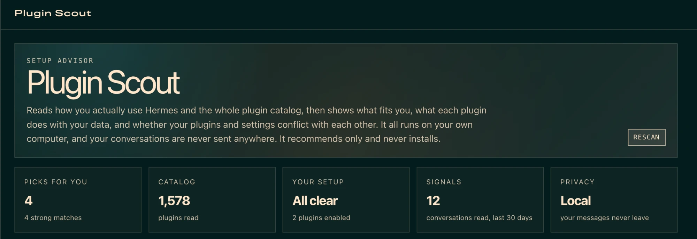
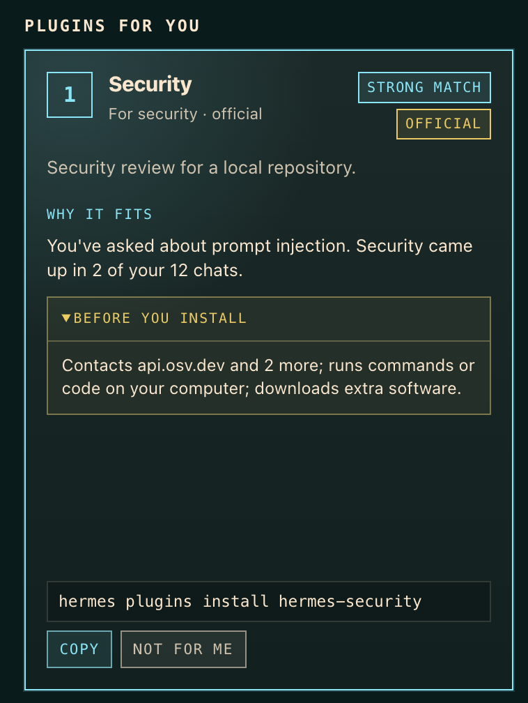
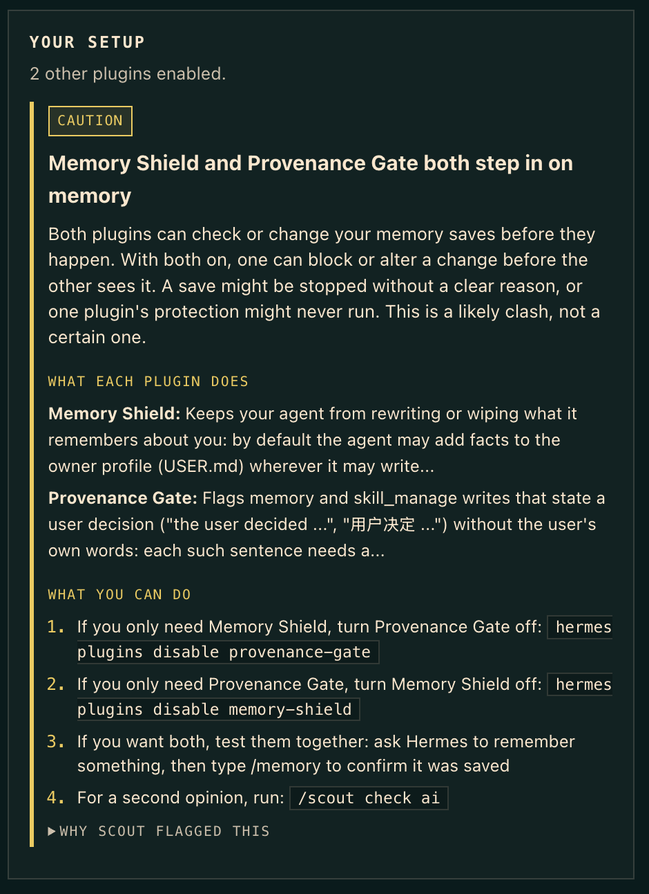

# Plugin Scout

New Hermes plugins land every week, faster than anyone can read the catalog.

Plugin Scout is like the veteran coworker who knows your job, notices how you work, and leans over to say "there's a free tool for that," or "heads up, that one needs a setting you don't have." It reads how you actually use Hermes, reads the whole catalog, and tells you what fits:

1. **Plugins that fit you.** Picks based on the tools you use and the topics you ask about, each with the evidence behind it.
2. **Heads-ups.** A plugin whose own warnings apply to your settings, an update waiting, known issues, or a plugin pulled from the catalog (that one always comes first).
3. **Clashes.** If you stack plugins that step in on the same tool, such as two guards on `terminal` or `memory`, it says so before they trip over each other.
4. **What is new for you.** A weekly note that stays quiet unless something matters to you.

It recommends. It never installs, enables or changes anything. Every suggestion ends with the command for you to run yourself.

## Install

```bash
hermes plugins install plugin-scout
hermes plugins enable plugin-scout
```



| A pick, with what it does with your data | A clash, explained, with what to do |
|---|---|
|  |  |

## Your first minute

Run `/scout` once. You do not wait a week for it to learn you:

1. **Your setup is checked right away.** Clashes, settings, updates and known issues need no history at all.
2. **It reads what Hermes already knows:** recent conversations, Hermes's memory of you, and skills you made.
3. **It shows picks so far,** each labelled *strong match* or *early guess*.
4. **It asks one question:** what do you want Hermes to handle for you? Answer with numbers, like `/scout interests 1, 10`, and the picks sharpen immediately. The 13 choices are jobs people most often give an AI assistant, checked against published usage studies and the plugins in the catalog: research, news and learning; writing, social posts and marketing; email, calendar and planning; coding, dev work and data; AI agents, models and automation; notes, memory and knowledge; images, video, music and voice; shopping, travel, food and weather; money, taxes and business; security and privacy; design, 3D and games; health and fitness; Hermes Desktop themes and add-ons. Between them they reach about three quarters of the catalog's 2,100+ plugins (checked against the live catalog on Nov 12, 2026); most of the rest are low-level plumbing for Hermes itself.

After that, it keeps learning from how you use Hermes. `/scout start` shows the welcome again.

## Use

**Just ask in plain words.** Most people talk to Hermes, not type commands, and Plugin Scout works that way too:

- "Get me started with Plugin Scout"
- "I'm into security and AI news" (saved as your interests)
- "What plugins would help me?" or "Why did you pick that?"
- "Do any of my plugins conflict?"

Hermes routes these to Plugin Scout's tools. Slash commands do the same things instantly and without using your model:

| Command | What it does |
|---|---|
| `/scout` | Overview: plugins that fit you, heads-ups, then any clashes |
| `/scout picks` | Plugins that fit how you use Hermes |
| `/scout picks ai` | A shorter, smarter shortlist with a reason for each |
| `/scout check` | Full check of your plugins: clashes, settings, updates, known issues |
| `/scout check ai` | Same, with an AI second opinion on likely clashes |
| `/scout start` | The welcome again: setup check, what Scout knows, one question |
| `/scout profile` | What Scout knows about how you use Hermes, and where each piece came from |
| `/scout interests <words>` | Tell Scout what you use or care about, e.g. `spotify, notion, prompt injection` (`clear` to reset) |
| `/scout dismiss <name>` | Stop suggesting a plugin |
| `/scout week` | This week's note: only what matters to you |
| `/scout new` | Everything that changed in the catalog since you last looked |
| `/scout seen` | Mark catalog changes as seen |
| `/scout refresh` | Download the catalog again now |

The agent has eight tools: `scout_start`, `scout_picks`, `scout_interests`, `scout_profile`, `scout_conflicts`, `scout_weekly`, `scout_whats_new` and `scout_dismiss`.

**Dashboard tab.** Run `hermes dashboard` and open **Plugin Scout** in the sidebar (it opens at `http://127.0.0.1:9119`, served from your own machine). Tap what you want Hermes to handle, see your picks with what each does, why it fits and what it does with your data, copy an install command, skip a pick, and check your setup, all on one page.

**Weekly note.** Open `/blueprint` and pick **Weekly plugin scout** to get it every Monday at a time you choose, in the chat it came from. Nothing is scheduled until you set it up.

### Example

```
Cloudflare Web Search (strong match)
  What it does: Cloudflare Web Search backend for Hermes' existing web_search tool, with Ceramic, Exa, or Linkup selected in plugin settings.
  For you: Hermes did 36 web searches for you. Web came up in 4 of your 10 chats.
  Heads up: It needs web.cache_enabled: false. Yours is true.
  Install: hermes plugins install cloudflare-web-search   Not for you: /scout dismiss cloudflare-web-search
```

```
mcp-serve [official] (strong match)
  What it does: Run Hermes as an MCP server: hermes mcp-serve lets any MCP client (Claude Code, Claude Desktop, Cursor, Codex) list and read your messaging conversations, poll...
  For you: It works with Claude and MCP, which you use or have brought up. You've asked about context engineering and multi-agent.
  Before you install: Can read your conversations; can send messages as you; can cost money or use up credits.
  Install: hermes plugins install mcp-serve   Not for you: /scout dismiss mcp-serve
```

```
Plugin Scout: 3 enabled plugin(s) checked. 1 to look at.

[CAUTION] Memory Shield and Provenance Gate both step in on `memory`
  - Both register `pre_tool_call`.
  - Both descriptions say they act on `memory`.
  - When both are on, either can block or change the call before the other sees it.
[KNOWN ISSUE] memory-shield: 5 known issues
  - Needs plugins.isolation: in_process (the default). Under plugins.isolation: host the plugin cannot see the current chat, sender or Hermes' review marker, so...
  - 4 more: hermes plugins info memory-shield
```

The last one is from `/scout check`, the full plugin check.

## How it decides

**Picks** come from counts, not from reading your conversations with a model. On your machine, Plugin Scout looks at four things:

1. **Your recent history:** which tools Hermes used for you, and about 20 everyday topics (calendar, email, music, news, travel, security, AI agents and so on) matched against fixed keyword lists in your own messages over the last 30 days.
2. **Hermes's memory of you** (`USER.md`, `MEMORY.md`): what you chose to tell Hermes about yourself, matched against the same lists.
3. **Skills you made or added.** Skills bundled with Hermes are skipped, since they say nothing about you.
4. **What you tell Scout** with `/scout interests`. This is the fastest fix for a new install with little history.

Scout counts **conversations, not words.** A topic that comes up in three chats says more than twenty hits inside one pasted article, so each conversation counts at most three hits. Runs of scheduled tasks are kept apart and count only for what the task is mainly about. Each pick is labelled **strong match** only when a direct signal (two or more conversations, repeated tool use, a skill you made, or something you told Scout) is backed by a second one. Anything less is an **early guess**. Things you chose to tell Hermes count more than passing mentions. Each pick also has a **before you install** line taken from the plugin's own catalog disclosure: where it sends your data, whether it can read your conversations or send messages as you, run commands, download software, move real money or cost credits, and which keys it needs. It only restates what the plugin declares. It respects a plain negation ("no shell commands") but prefers a false alarm over a false all-clear, and it never calls a plugin safe: with no disclosure, or nothing specific found, it says so and points you to `hermes plugins info`. Each pick says **what it does** (the plugin's own words from the catalog) and **why it fits you**, using the most specific reasons first: a product you named that the plugin works with, a skill you built, phrases you used, then how much Hermes did for you. Counts are a last resort. The best plugin from each of your topics comes first, so one strong interest cannot fill the whole list. Official and verified plugins get a small boost, plugins with known issues a small penalty. `/scout profile` shows exactly what went into your picks.

**Settings** come from each plugin's own known issues. Many name a Hermes setting ("Needs plugins.isolation: in_process", "Set web.cache_enabled: false"). Plugin Scout reads those settings in your config and speaks up only when the warning applies to you, on installed plugins and on picks alike. Tested against every plugin in the catalog on a typical setup, it flagged only the one warning that truly applied.

**Clashes** are uncommon: only a few dozen catalog plugins step in on Hermes's built-in tools, so this mostly matters once you stack guard or safety plugins, most often on `terminal` and `write_file`. They come from what each plugin declares (its tools, hooks and middleware) plus its catalog description. Many plugins use the same hooks, so a shared hook alone is not a conflict. A caution needs both a shared tool-level hook and the same tool named in both descriptions. These are labelled "likely", not proven. `/scout check ai` asks your model for a one-word second opinion and downgrades the ones it judges separate.

## Privacy and what it touches

What a careful user would want to know before installing:

- **Network.** One download only: the public catalog index from `hermes-agent.nousresearch.com`, which redirects to Nous's GitHub Pages site `nousresearch.github.io/hermes-agent` (about 1.7 MB), cached for 6 hours. It refuses any other address or redirect. No telemetry, no analytics, no other servers.
- **Reads outside its own data (read-only).**
  - Your Hermes session history, last 30 days, up to 200 sessions, opened read-only. Used only to count tools and topic keywords.
  - Hermes's memory files (`memories/USER.md`, `MEMORY.md`, up to 64 KB each) and your skill list, to match topics. Nothing from them is stored or sent; only topic names, counts and your own skill names appear in Scout's output.
  - `config.yaml`: the list of enabled plugins, the memory provider, and any setting a plugin's known issues name (to check whether the warning applies to you). Settings that look like credentials (keys, tokens, secrets, passwords) are never read, and your own value is shown only for that plugin's own settings and a few harmless ones; otherwise Scout just says yours differs.
  - Other installed plugins' `plugin.yaml` files and Hermes's install record (`plugins/.install-metadata.json`), to see what you have and which version.
- **Writes.** Only its own plugin data folder (the catalog cache) and its own plugin state (the "last looked" snapshot, your dismissed list, and interests you give it).
- **Model calls.** Only when you ask for `ai` (or the agent sets `ai_rank` / `ai_check`). They go to the model you already use, through Hermes. What is sent: per-topic counts (for example `{"music": {"conversations": 3, "in_memory": true}}`) and public catalog descriptions. Not your messages, not your memory text, not your skill names, not your own interest words. **Your message text is never sent.** A test plants a fake PIN in a chat and fails if it ever reaches a prompt. With a small model this costs a fraction of a cent per run.
- **Never.** No shell commands, no background processes, no credentials, no installs, no changes to other plugins or your config, no overrides of Hermes internals.

## Roadmap

- **One exploring pick:** reserve one slot for a plugin just outside your current topics, so Scout learns what else you like (the explore/exploit idea from recommender research).
- **Dismissals that teach:** skipping several picks in a topic lowers that topic, not only the plugin.
- **`/scout more` and `/scout less`:** steer topics directly.
- **Recency:** weigh last week more than last month.

## Security

Catalog text, other plugins' manifests and model replies are treated as untrusted: cleaned of escape codes and invisible characters, length-capped, and fenced off as data in AI prompts. The model can add a one-word opinion but can never hide a finding, and its own words are never shown. Scout only suggests changing a plugin's own settings or a few harmless ones, never core Hermes settings. See [SECURITY.md](SECURITY.md) for the threat model and how to report a problem.

**Use in shared chats:** Scout reads your history across all your chats. If your Hermes answers in a shared group chat, don't enable Scout's tools there, since anyone in the chat could ask for your picks or profile.

## Development

No extra packages to install: it uses the Python standard library plus what Hermes already ships. Tests (including hostile-input tests and regression tests from an independent security review) run on every push in GitHub Actions:

```bash
python3 -I -m unittest discover -s tests
```

Catalog check:

```bash
hermes plugins validate .
```

## License

MIT
